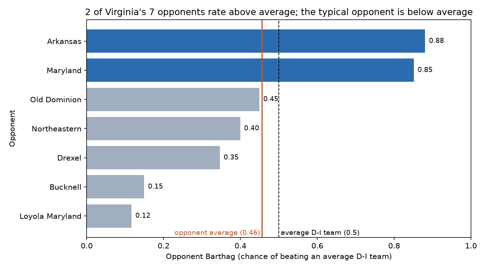
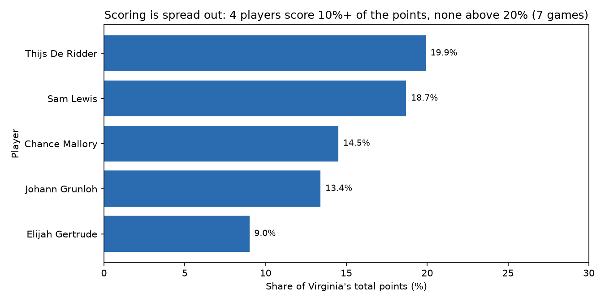

# Virginia Reality Check

DS2002 Fall 2026 Individual Capstone.

This project asks two questions about Virginia men's basketball:

1. Has Virginia's record been earned against strong opponents?
2. Who has carried the team so far?

## Summary

Covers Virginia's first 7 games (all wins, played Nov 3 to Nov 20, 2026), using data pulled on November 21, 2026.

### Q1. How strong have Virginia's opponents been?

Virginia men's basketball schedule has been mostly weak, with only two actual "tests". The average Barthag of Virginia's 7 opponents is **0.456**. That is slightly below 0.5, the rating of an average Division I team. Torvik's own strength-of-schedule figure for Virginia is **0.423**, which also puts the schedule below average. The two numbers differ because Torvik computes its strength-of-schedule figure with its own method, while mine is calculated as an average of opponent ratings.

Only **2 of the 7 opponents** Virginia men's basketball has faced off against rate above average:

- **Arkansas** (0.88): Virginia won 91–72 at a neutral site.
- **Maryland** (0.85): Virginia won 87–83 on the road.

The other five opponents range from 0.12 (Loyola Maryland) to 0.45 (Old Dominion), and Virginia beat all five at home by 20 points or more. The 7–0 record is still legit, and Torvik does rates Virginia at 0.944 (a score that sets them up as one of the best teams in the country). Most of Virginia's record, though, has come from playing against below-average teams. The wins over Arkansas and Maryland are the strongest evidence that Virginia is as good as Torviks record suggests.

### Q2. Who carries Virginia?

Scoring is pretty spread out rather than carried by one or two players. Over 7 games, Virginia scored **647 points**:

- **Thijs De Ridder**: 129 points, accounting for **19.9%** of Virgina's points, and the leading scorer on UVA so far.
- **Sam Lewis**: 121 points, 18.7%.
- **Chance Mallory**: 94 points, 14.5%.
- **Johann Grunloh**: 87 points, 13.4%.

The top two players combine for 38.6% of the points. The top five combine for 75.5%. Four different players each produce more than 10%.

Thijs De Ridder is also the team leader in rebounds (54) and steals (16), so I think he is the closest thing to a player who carries the team. In terms of blocks, Johann Grunloh leads with 21, far more than anyone else.

## Data sources

All three were most recently pulled on **2026-11-21** and saved in `raw/` with that date in the file name.

| Source | Address | Saved as |
|---|---|---|
| Torvik ratings (CSV) | https://barttorvik.com/2027_team_results.csv | `raw/torvik_2027_team_results_2026-11-21.csv` |
| ESPN team schedule (JSON) | https://site.api.espn.com/apis/site/v2/sports/basketball/mens-college-basketball/teams/258/schedule | `raw/espn_schedule_2026-11-21.json` |
| ESPN game summary (JSON), one per finished game | https://site.api.espn.com/apis/site/v2/sports/basketball/mens-college-basketball/summary?event=GAME_ID | `raw/espn_summary_<game_id>_2026-11-21.json` (7 files) |

Games played after November 21 are not included per assignment instructions.

## How to run

Requires Python 3 with pandas, matplotlib, and Jupyter:

    py -m pip install pandas requests matplotlib notebook

1. Open Jupyter with `py -m notebook` and open `uva_reality_check.ipynb`.
2. Choose Run → Restart Kernel and Run All Cells.

The notebook reads only the saved files in `raw/`, so it doesn't need internet. It creates `uva.db`, `decision_log.csv`, and the two charts in `charts/`. To pull fresh data instead, run `py download_data.py`, then change `PULL_DATE` in the first code cell to the new date.

## Files

| File | What it is |
|---|---|
| `uva_reality_check.ipynb` | The full pipeline, the SQL queries, and the charts |
| `download_data.py` | Downloads the three sources into `raw/` |
| `raw/` | The raw files exactly as downloaded |
| `uva.db` | SQLite database with four tables: `teams`, `ratings`, `games`, `player_games` |
| `decision_log.csv` | Every choice I made that changed the data (with row counts) |
| `charts/` | The two charts in my uva_reality_check.ipynb as PNG files |

## Decision log

| Step | Decision | Rows before → after |
|---|---|---|
| games | Kept only finished games (`status.type.completed == True`) | 31 to 7 |
| games | Converted start times from UTC to Eastern before taking the date. 5 of the 7 games moved to the previous calendar day. | 7 to 7 |
| teams | Renamed 1 ESPN opponent to match Torvik's spelling: "Loyola Maryland" → "Loyola MD" | 7 to 7 |
| teams | Checked for opponents with no Torvik row (non-Division I). There were none, so all 7 opponents are rated. | 7 to 7 |
| player_games | Dropped roster rows for players who did not play (empty stats list) | 126 to 99 |
| player_games | Kept box-score rows only for finished games | 99 to 99 |

Check: in every game, the players' points add up to Virginia's final score from the schedule.

Rerun check: loading `uva.db` a second time leaves every row count unchanged (teams 8, ratings 365, games 7, player_games 99).

## AI use

- Claude helped me develop a way to download the three sources into `raw` using `download_data.py`.
- Claude helped troubleshoot any coding erros for why my notebook wasn't running, and checked over my work at the end for sanity sake.